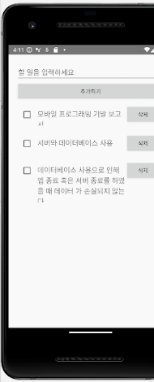
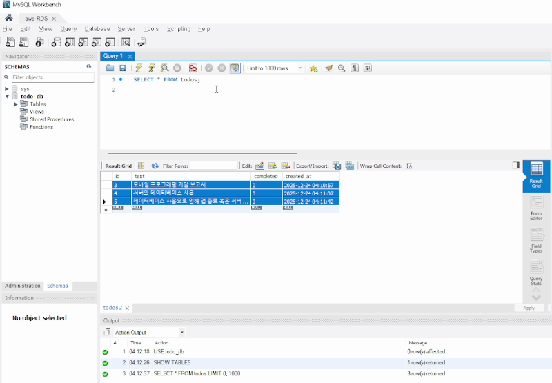
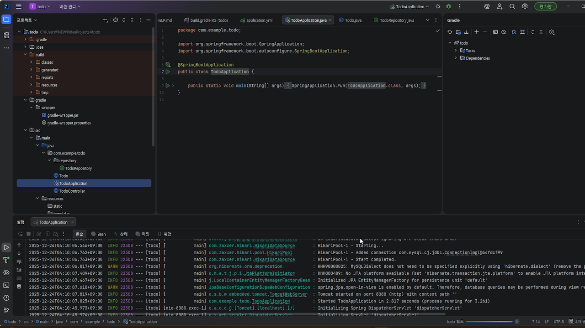

# Mobile To-Do — 앱 · 서버 · 클라우드 DB 연결

2025년 2학기 모바일프로그래밍 기말 과제 (2025.12 제출)

로컬 `ArrayList`에만 저장하던 투두리스트 앱을 **앱 → REST 서버 → AWS RDS** 구조로 바꿔,
앱을 껐다 켜도 데이터가 남도록 만들었습니다.

```
Android 앱 (Kotlin · Retrofit)
   │  HTTP  GET / POST / DELETE  /api/todo
   ▼
Spring Boot 서버 (Java · Spring Data JPA)
   │  JDBC
   ▼
AWS RDS (MySQL)  todo_db.todos
```

| 구분 | 내용 |
|---|---|
| `android/` | Retrofit으로 목록 조회·추가·삭제, RecyclerView 목록 |
| `server/` | `TodoController` REST API, JPA 엔티티 `Todo`(생성 시각 자동 기록) |
| DB | AWS RDS MySQL. 접속 정보는 환경변수(`DB_URL`, `DB_USERNAME`, `DB_PASSWORD`)로 주입 |

## 동작 화면

앱에서 추가한 할 일이 서버를 거쳐 RDS의 `todo_db.todos` 테이블에 저장된다.

| 앱 (에뮬레이터) | RDS 조회 (MySQL Workbench) |
|:---:|:---:|
|  |  |

Spring Boot 서버가 RDS에 연결(HikariPool)하고 8080 포트로 요청을 받는 화면:



## 실행

```bash
# server/
export DB_URL='jdbc:mysql://<rds-endpoint>:3306/todo_db?useSSL=false&serverTimezone=Asia/Seoul'
export DB_USERNAME=<user> DB_PASSWORD=<password>
./gradlew bootRun     # :8080
```

앱은 안드로이드 에뮬레이터에서 실행하며, `10.0.2.2:8080`(에뮬레이터에서 본 호스트 PC)으로 서버에 접속합니다.

## 참고

- 제출 보고서에 실린 소스를 옮겨 정리한 저장소라 Gradle 빌드 파일 등 프로젝트 설정 파일은 포함되어 있지 않습니다.
- 체크박스 완료 상태는 서버에 저장하지 않고 화면에서만 바뀝니다.
